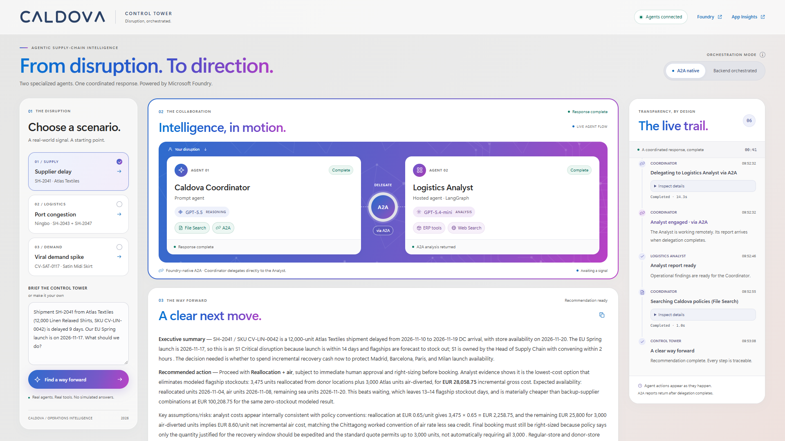
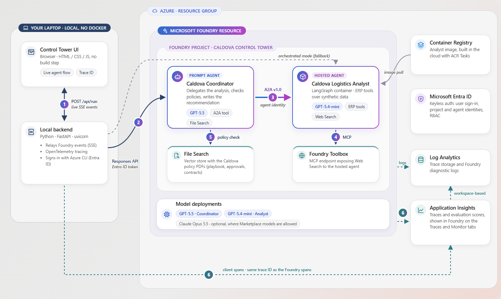

# Caldova Control Tower — a Microsoft Foundry multi-agent demo

Two **Microsoft Foundry agents** handle a supply-chain disruption together. A **prompt agent** delegates the analysis to a **hosted LangGraph agent** over **A2A**, checks company policy with **File Search**, and writes a decision-ready recommendation. A local web app shows every step live, and each run is traced end to end in Application Insights and the Foundry portal.

> *Caldova* is a fictitious company, and all data in this repo is synthetic.



## What this demo shows

- **Two ways to build agents in Foundry**
  - The *Caldova Coordinator* is a declarative **prompt agent**.
  - The *Caldova Logistics Analyst* is a **hosted agent**: custom LangGraph code in a container, built in the cloud.
- **Different models per agent:** GPT-5.5 for the Coordinator and GPT-5.4-mini for the Analyst. Claude Opus 5.5 is optional where available.
- **Agent-to-agent (A2A):** the Coordinator calls the Analyst directly inside Foundry, using its own agent identity.
- **Foundry tools:**
  - **File Search** over policy PDFs (Coordinator).
  - A **Foundry Toolbox (MCP)** with **Web Search** (Analyst).
  - Custom ERP tools inside the LangGraph graph.
- **Observability:** one distributed trace spans the local backend, the Foundry service and the hosted container (`invoke_agent`, `chat`, `execute_tool`, A2A `SendMessage`). It is viewable under **Agents → Traces** in the Foundry portal and in Application Insights. The Coordinator is also **continuously evaluated** for answer quality on the **Monitor** tab.
- **Keyless security:** the agents, models, tools and container registry all use Microsoft Entra ID, with no API keys, and local auth is disabled on the Foundry resource. The one exception is telemetry: Application Insights is linked to the project through its standard ingestion connection string, which the app reads from the project at runtime.
- **Local, simple app:** a Python FastAPI backend plus a no-build HTML/JS frontend that uses system fonts only (no external assets). No Docker, nothing deployed to the cloud.

## Architecture



Open [`docs/architecture.html`](docs/architecture.html) in a browser for the full diagram with the numbered flow and legend.

| | Caldova Coordinator | Caldova Logistics Analyst |
|---|---|---|
| Foundry agent type | Prompt agent | Hosted agent (LangGraph container) |
| Model | GPT-5.5 | GPT-5.4-mini (or Claude Opus 5.5) |
| Tools | A2A (to the Analyst) · File Search | Foundry Toolbox → Web Search (MCP) · ERP tools |
| Role | Delegates, checks policy, recommends | Quantifies stockouts, costs and recovery options |

**Run modes** (toggle in the UI):
- **A2A native** (default):
  1. The Coordinator's *delegate* version (A2A tool only) calls the Analyst through Foundry A2A.
  2. The Coordinator's *policy* version (File Search) reviews the Caldova policies and writes the final answer.
- **Backend orchestrated** (fallback): the local backend calls Coordinator → Analyst → Coordinator. The Analyst's tool calls stream live in the UI.

## Demo story

Shipment **SH-2041** (12,000 Linen Relaxed Shirts from supplier *Atlas Textiles*) is **9 days late**, two weeks before the EU spring launch.
1. The Analyst checks shipments, inventory and demand, then compares *wait*, *air freight*, *backup supplier*, *stock reallocation* and combinations.
2. The Coordinator applies the policies: approval thresholds, the supplier's late-delivery penalty and the disruption playbook.
3. It returns a plan with costs, approvers, a supplier claim and next steps.

Two more scenarios are included: **port congestion** (two shipments) and a **viral demand spike**.

➡️ **Presenting?** Follow the step-by-step [presenter guide](docs/DEMO_GUIDE.md).

## Repository layout

```
app/
  backend/                FastAPI app: SSE relay of Foundry events, OpenTelemetry tracing
  frontend/               Control Tower UI (HTML/CSS/JS, no build step)
agents/
  coordinator/            Prompt-agent instructions (delegate + policy versions)
  logistics_analyst/      Hosted LangGraph agent: main.py, erp_tools.py, synthetic ERP data, Dockerfile
data/documents/           Synthetic Caldova policies (.md sources and .pdf files used by File Search)
infra/main.bicep          Foundry resource + project, model deployments, ACR, Log Analytics,
                          Application Insights (+ project connection), diagnostics, RBAC
scripts/                  deploy_all, provision, deploy_analyst + register_analyst (ACR cloud
                          build + hosted-agent registration), setup_coordinator, smoke_test,
                          setup_evaluations, generate_documents (policy PDFs), verify_offline, teardown
docs/                     Architecture diagram (HTML + PNG), presenter guide, UI screenshot
start.ps1                 Starts the local app
```

## Prerequisites

- Windows with PowerShell 7, Python 3.13+ (tested with 3.14), [uv](https://docs.astral.sh/uv/), and Azure CLI 2.80+.
- An Azure subscription where you are **Owner** (or **Contributor** plus **User Access Administrator**), because the deployment creates role assignments.
- Model quota in a region that supports Foundry hosted agents (the default is **East US 2**). The default deployment uses **GPT-5.5 Global Standard: 900K tokens per minute** and **GPT-5.4-mini Global Standard: 200K tokens per minute**. Check your quota on the Foundry portal's quota page, or in PowerShell:

  ```powershell
  az cognitiveservices usage list --location eastus2 -o json | ConvertFrom-Json |
    Where-Object { $_.name.value -in 'OpenAI.GlobalStandard.gpt-5.5', 'OpenAI.GlobalStandard.gpt-5.4-mini' } |
    Select-Object @{ n = 'Model'; e = { $_.name.value } }, currentValue, limit
  ```

  Available capacity is `limit` minus `currentValue`. If you have less, pass smaller values; see [Deployment options](#deployment-options).
- **No Docker needed:** the hosted agent's image is built in the cloud with ACR Tasks.

**About Claude:** partner models such as Claude are purchased through Azure Marketplace, and some subscriptions can't buy them. Deployment then retries automatically without Claude, and the Analyst uses GPT-5.4-mini. Pass `-NoClaude` to skip the attempt.

## Quick start

```powershell
# 0. Get the code
git clone https://github.com/miguelmodel/20261116_Foundry_Caldova_agents_demo.git
cd 20261116_Foundry_Caldova_agents_demo

# 1. Python environment
uv venv --python 3.14 .venv
uv pip install --python .venv\Scripts\python.exe -r requirements.txt --prerelease=allow

# 2. Sign in and choose the subscription to deploy into
az login
az account set --subscription <your-subscription-id>

# 3. Deploy everything (about 15–20 min) and run the smoke test
.\scripts\deploy_all.ps1 -NoClaude   # -NoClaude: Analyst on GPT-5.4-mini (drop it to try Claude)

# 4. Start the app
.\start.ps1                          # opens http://127.0.0.1:8000
```

The app runs until you press **Ctrl+C** or close that terminal; run `.\start.ps1` again after a reboot. If port 8000 is already in use, the app is probably still running, so just open http://127.0.0.1:8000.

`--prerelease=allow` is required because `langchain-azure-ai` depends on beta Azure SDKs. If the repo lives in a OneDrive folder and `uv` fails with a hardlink error, set `$env:UV_LINK_MODE="copy"`, delete `.venv` and run step 1 again.

`deploy_all.ps1` runs five steps:
1. `provision.ps1`: deploys the Bicep templates and writes your local `.env`.
2. `deploy_analyst.ps1`: builds the image in ACR, creates the Web Search toolbox, registers the hosted agent, enables A2A and assigns RBAC.
3. `setup_coordinator.py`: indexes the policy PDFs, creates the A2A connection and both Coordinator versions, and assigns RBAC.
4. `smoke_test.py`: checks the Analyst, the A2A delegation and File Search.
5. `setup_evaluations.py`: turns on continuous evaluation for the Coordinator and uploads the Analyst's evaluation dataset (see [Quality evaluation](#quality-evaluation)).

More detail is in [`scripts/README.md`](scripts/README.md) and [`app/README.md`](app/README.md).

### Deployment options

`deploy_all.ps1` (and `provision.ps1`) accept these optional parameters:

| Parameter | Default | Purpose |
|---|---|---|
| `-SubscriptionId` | the subscription in `.env`, else the active Azure CLI subscription | Where to deploy. |
| `-ResourceGroup` | `rg-caldova-foundry-demo` | Created if it doesn't exist. Use a new name for a second copy. |
| `-Location` | `eastus2` | Must support Foundry hosted agents and both models. |
| `-NoClaude` | off | Skip the Claude attempt and use GPT-5.4-mini for the Analyst. |
| `-CoordinatorCapacity` | `900` | GPT-5.5 capacity, in thousands of tokens per minute. |
| `-AnalystCapacity` | `200` | GPT-5.4-mini capacity (Analyst and evaluation judge), in thousands of tokens per minute. |

For example, for a subscription with less quota:

```powershell
.\scripts\deploy_all.ps1 -SubscriptionId <your-subscription-id> -NoClaude -CoordinatorCapacity 300 -AnalystCapacity 100
```

Lower capacity works, but long multi-agent runs are more likely to hit rate limits (HTTP 429). If that happens, wait a minute and run again.

**Quota check:** before creating anything, `provision.ps1` compares the requested capacity with your available quota in the region. If there isn't enough, it stops with a message like this, and nothing is deployed:

```text
Not enough model quota in eastus2 for subscription <id>. Nothing was deployed.
  - GPT-5.5 (Global Standard): needs 900K tokens per minute, but only 200K are available (quota 2000K, already in use 1800K).
  Re-run with lower capacity, for example: .\scripts\deploy_all.ps1 -CoordinatorCapacity 200
  Or choose another region with -Location, or request more quota for the model in the Azure portal.
```

Your subscription ID, resource names and agent versions are written only to your local, git-ignored `.env`; nothing is committed.

### Deployment troubleshooting

| Message | What to do |
|---|---|
| `Not enough model quota in <region>` | Re-run with the suggested `-CoordinatorCapacity` / `-AnalystCapacity`, another `-Location`, or request more quota. |
| `InsufficientQuota` from Azure | Same as above. Azure checks quota again during deployment. |
| `AuthorizationFailed` on `roleAssignments` | You need **Owner**, or **Contributor** plus **User Access Administrator**, on the subscription. |
| `Subscription … is 'Disabled'` | Re-enable the subscription, or pass another `-SubscriptionId`. |
| Warning: retrying without Claude | Expected when your subscription can't buy Azure Marketplace models. Use `-NoClaude` to skip the attempt. |
| `uv` fails with a hardlink error | Set `$env:UV_LINK_MODE="copy"`, delete `.venv` and reinstall (common in OneDrive folders). |

Every script can be re-run safely after fixing the cause.

## Configuration

All settings live in a local **`.env`** file, which the deployment scripts create. It is **git-ignored**; see [`.env.example`](.env.example) for the keys.

Optional settings:
- **`AZURE_CONFIG_DIR`**: points the scripts and the app at a dedicated Azure CLI profile. This is useful if you switch between several subscriptions or tenants. Sign in to that profile once with `$env:AZURE_CONFIG_DIR="$env:LOCALAPPDATA\caldova-demo-azure"; az login` (use the same folder as in `.env`).
- **`infra/tags.local.json`** (git-ignored): extra tags merged into every resource, if your organization requires them. It's a flat JSON object of tag names and values, for example `{ "owner": "my-team" }`.

## Observability

Every run shows a **trace ID** in the UI. That trace includes:

| Component | Example spans |
|---|---|
| Local backend | `POST /api/run`, `caldova.control_tower.run`, `invoke_agent caldova-coordinator` |
| Foundry service | `invoke_agent caldova-coordinator:<version>`, `chat gpt-5.5…`, `execute_tool remote_a2a_caldova-analyst-a2a.SendMessage`, `execute_tool file_search.msearch`, `invoke_agent caldova-logistics-analyst:<version>` |
| Hosted agent | `invoke_agent Caldova Logistics Analyst`, `chat gpt-54-mini`, `execute_tool get_inventory_position`, … |

Where to view it:
- **Foundry portal → Agents → (agent) → Traces**: search by trace ID or response ID. Traces take about 2–5 minutes to appear.
- **Build → (agent) → Monitor**: token usage, latency, success rate and evaluation scores. Operational metrics take about 10–15 minutes to appear. Evaluation scores are processed in batches and can take from 15 minutes to a few hours after a run.
- **Application Insights → Transaction search**: the full end-to-end waterfall.
- **Log Analytics**: diagnostic logs of the Foundry resource.

The Bicep template grants the deploying user **Log Analytics Reader** on Application Insights and its workspace, so the trace and Monitor views work without extra setup. It also grants the project's managed identity **Reader** on Application Insights (plus Log Analytics Reader on the workspace), which trace-based evaluation needs.

## Quality evaluation

Built-in Foundry evaluators (**task adherence**, **intent resolution**, **coherence**) score each agent's answers, with **GPT-5.4-mini** as the judge.

| Agent | How it's evaluated | Where to see it |
|---|---|---|
| Coordinator (prompt agent) | A **continuous evaluation rule** scores live responses from both Coordinator versions automatically: 100% sampled, capped at 30 runs per hour. | **Build → caldova-coordinator → Monitor**, and as `gen_ai.evaluation.result` events in Application Insights |
| Analyst (hosted agent) | Continuous-evaluation rules don't support hosted agents yet, so the Analyst is scored by an **agent evaluation run** over the three demo scenarios (dataset `caldova-analyst-scenarios`). | **Build → Evaluations** |

**What the scores look like.** The policy step usually passes all three checks. The delegate step often *fails* task adherence: its instructions ask for a short summary without a recommendation, its summary usually names the best option anyway, and the judge doesn't see the A2A tool call as evidence. Coherence and intent resolution still pass. It's a real example of continuous evaluation catching an agent drifting from its instructions.

To start the Analyst run, use the portal: **Build → Evaluations → Create**, target **caldova-logistics-analyst**, dataset **caldova-analyst-scenarios**, and the three evaluators above.

`python scripts/setup_evaluations.py --run-analyst-eval` can also start it from the command line. That needs a user token Foundry can exchange on your behalf, and with some sign-in setups it fails with *"Getting user token was not successful"*. In that case, use the portal. Tune `EVAL_MODEL_DEPLOYMENT`, `EVAL_SAMPLING_RATE` and `EVAL_MAX_HOURLY_RUNS` in `.env`.

## Clean up

```powershell
.\scripts\teardown.ps1               # deletes the agents, then the resource group
```

## Notes and limitations

- This is a **demo**, not production code. It uses synthetic data and public endpoints protected by Entra ID, with no network isolation. Review your organization's policies before deploying.
- A2A responses are not streamed, so the Analyst's internal steps are live only in *Backend orchestrated* mode. In A2A mode they appear in the traces.
- The A2A tool sets `send_credentials_for_agent_card=True`, because Foundry agent cards require Entra authentication.
- Coordinator requests cap `max_output_tokens`, and the GPT-5.5 deployment has extra capacity, so multi-step tool loops stay within the tokens-per-minute limit.
- Model and tool behavior varies between runs, so exact numbers in the recommendation can differ slightly.
- Running the demo incurs Azure costs for models, hosted-agent compute, ACR and monitoring. Run the teardown when you're done.
